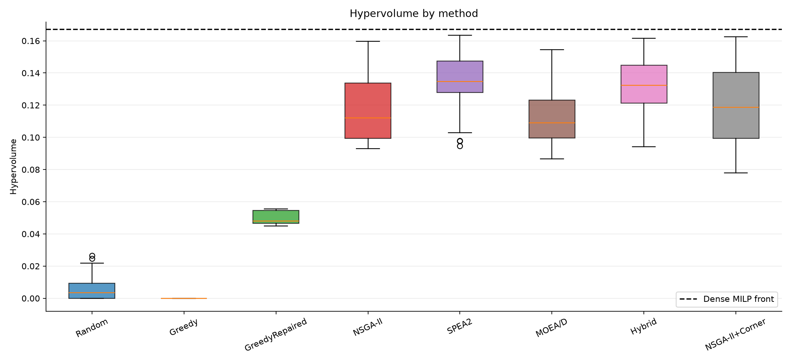
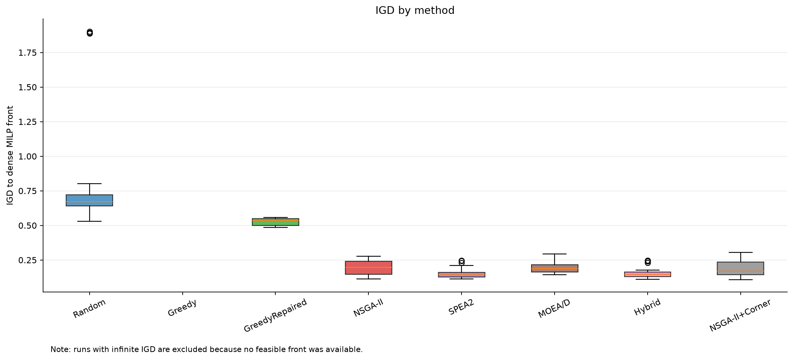
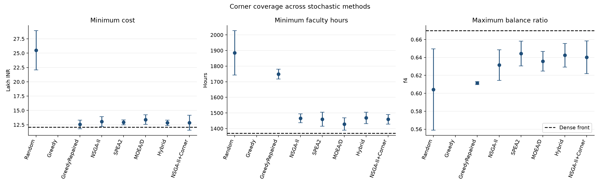
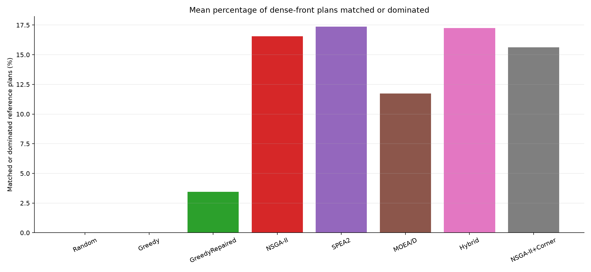
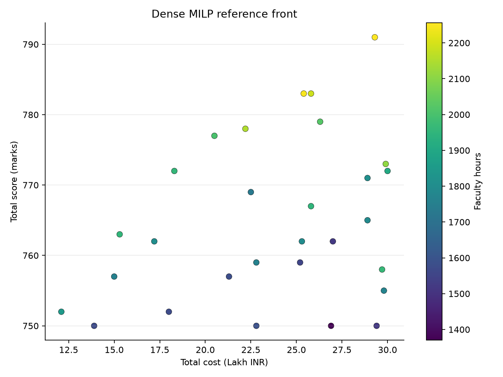

# NBA Accreditation Improvement Planning

Multi-objective planning for improving a synthetic undergraduate engineering programme's NBA accreditation profile under cost, faculty-time, scheduling, and prerequisite constraints.

> **Synthetic-data notice:** Institutional parameters, actions, profile marks, and benchmark instances in this repository are synthetic. They are for research and educational benchmarking, not a forecast of any institution's real NBA marks.

## Contents

- [Overview](#overview)
- [The problem in detail](#the-problem-in-detail)
- [Mathematical formulation](#mathematical-formulation)
- [Why the objectives conflict](#why-the-objectives-conflict)
- [Methods](#methods)
- [How the project evolved](#how-the-project-evolved)
- [Results](#results)
- [How to reproduce](#how-to-reproduce)
- [Repository structure](#repository-structure)
- [Data](#data)
- [Team and contributions](#team-and-contributions)
- [References](#references)

## Overview

NBA (National Board of Accreditation) accreditation evaluates an engineering programme across ten criteria. This project models the planning question as: which integer quantities of evidence and improvement actions should a programme undertake, and in what feasible combination, to improve its score while respecting a 30.0 Lakh INR budget, a 12-month horizon, monthly faculty capacity, and action prerequisites?

Programme leaders and accreditation committees make the resource-allocation decisions. Faculty, students, programme staff, and institutional support teams are affected because the actions consume money, faculty hours, administrative attention, and calendar capacity.

With 45 actions and integer upper bounds, the medium instance contains more than $3.5 \times 10^{13}$ possible plans before constraints are applied. Exhaustive search is therefore unsuitable; exact optimization and multi-objective heuristics provide complementary views of the trade-offs.

The final medium-instance benchmark uses the dense MILP front as the yardstick. The dense front has 29 plans and hypervolume 0.167292 under the final benchmark normalization. Across 30 seeds, SPEA2 has mean hypervolume 0.134144, Hybrid-Memetic without MILP seeding 0.131149, NSGA-II 0.117350, NSGA-II+Corner 0.121401, and MOEA/D 0.112465. Random and Greedy-Baseline produce almost no feasible plans; GreedyRepaired is feasible on a small fraction of its samples. These comparisons are quality indicators for the synthetic instance, not institutional recommendations.

## The problem in detail

The working criterion maxima, synthetic profile, and minimum floors are:

| Criterion | Code | Focus | Maximum marks | Current marks | Minimum level |
|---:|:---:|---|---:|---:|---:|
| 1 | C1 | Vision, mission and PEOs | 50 | 38 | 25 |
| 2 | C2 | Curriculum and teaching-learning | 100 | 70 | 50 |
| 3 | C3 | Course outcomes and programme outcomes | 175 | 110 | 87.5 |
| 4 | C4 | Students' performance | 100 | 70 | 60 |
| 5 | C5 | Faculty information and contributions | 200 | 100 | 120 |
| 6 | C6 | Facilities and technical support | 80 | 58 | 48 |
| 7 | C7 | Continuous improvement | 75 | 38 | 37.5 |
| 8 | C8 | First-year academics | 50 | 36 | 25 |
| 9 | C9 | Student support systems | 50 | 34 | 25 |
| 10 | C10 | Governance, institutional support and financial resources | 120 | 96 | 60 |
| **Total** |  |  | **1000** | **650** |  |

The configured planning limits are:

- Budget: $B = 30.0$ Lakh INR.
- Planning horizon: $T = 12$ months.
- Monthly faculty capacity: $K_m = 300.0$ hours.
- Accreditation target: $R = 750.0$ marks.
- Actions: 45 evidence and improvement actions.
- Evidence packages $E_1,\ldots,E_{10}$ and action prerequisites are represented in `data/actions.csv`.

The action table records cost, faculty hours, duration, maximum units, score gain, evidence status, prerequisites, and traceability references. Proposal action A12 remains assigned to C4 in the action data even though its SAR references point to C2.

## Mathematical formulation

Let $C$ be the set of criteria and $A$ the set of actions.

- $x_a$: integer units selected for action $a$.
- $u_a$: maximum units of action $a$.
- $M_c$: maximum marks for criterion $c$.
- $s_{0c}$: baseline marks for criterion $c$.
- $g_a$: marks gained by one unit of action $a$.
- $q_a$: cost of one unit of action $a$ in Lakh INR.
- $h_a$: faculty hours for one unit of action $a$.
- $d_a$: duration of action $a$ in months.
- $S_a,F_a$: earliest start and finish months.
- $L_c$: minimum level for criterion $c$.
- $B,T,K_m,R$: budget, horizon, monthly capacity, and required total score.

### Decision variables

For each action, the decision is an integer number of implemented units:

$$
x_a \in \mathbb{Z}_{\ge 0}, \qquad x_a \le u_a \quad \forall a \in A.
$$

This chooses a bounded integer plan rather than a fractional action quantity.

### Capped criterion scores

$$
\text{Score}_c(x)=\min\left(M_c,\ s_{0c}+\sum_{a\in A:\text{crit}(a)=c}g_a x_a\right).
$$

Each criterion stops gaining marks after its working maximum.

### Four objectives

$$
\max f_1(x)=\sum_{c\in C}\text{Score}_c(x).
$$

The first objective maximizes total accreditation marks.

$$
\min f_2(x)=\sum_{a\in A}q_a x_a.
$$

The second objective minimizes total cost.

$$
\min f_3(x)=\sum_{a\in A}h_a x_a.
$$

The third objective minimizes total faculty effort.

$$
\max f_4(x)=\min_{c\in C}\frac{\text{Score}_c(x)}{M_c}.
$$

The fourth objective maximizes the weakest criterion's normalized ratio.

### Constraints

1. **Budget**

$$
f_2(x)\le B.
$$

The selected actions must fit within the 30.0 Lakh INR budget.

2. **Monthly faculty hours**

$$
F_a=d_a+\max_{b\in\text{prereq}(a)}F_b,\qquad
S_a=F_a-d_a.
$$

Prerequisites determine an earliest-start schedule; an action with no prerequisite uses zero in the maximum.

$$
H_m(x)=\sum_{a\in A:S_a < m \le F_a}\frac{h_a}{d_a}x_a\le K_m
\quad \forall m\in\lbrace 1,\ldots,T \rbrace.
$$

Faculty effort is spread across active months and cannot exceed monthly capacity.

3. **Deadline**

$$
x_a=0\quad\text{if }F_a>T.
$$

Actions finishing after the 12-month horizon cannot be selected.

4. **Prerequisites and evidence**

$$
x_a\le u_a x_b\quad \forall a\in A,\ b\in\text{prereq}(a).
$$

Selecting a dependent action requires its prerequisite action units; the evidence-package relationships are encoded in the same prerequisite structure.

5. **Minimum criterion levels**

$$
\text{Score}_c(x)\ge L_c\quad\forall c\in C.
$$

Every criterion must meet its configured minimum level.

6. **Required total score**

$$
f_1(x)\ge R.
$$

Feasible plans must reach the configured 750-mark accreditation target.

This is a pure-integer, four-objective optimization problem: a knapsack with precedence, scheduling, and quality-floor constraints. It is NP-hard.

## Why the objectives conflict

Higher scores generally require more actions, which increases cost and faculty effort. Conversely, low-cost or low-hour plans may leave score potential unused. Maximizing total marks can also concentrate investment in high-yield criteria, while maximizing $f_4$ requires raising the weakest criterion, so total score and balance can pull the plan in different directions.

## Methods

- **Random-Baseline** (`src/baseline/random_search.py`): samples repaired plans and provides a deliberately simple stochastic baseline.
- **Greedy-Baseline** (`src/baseline/greedy.py`): ranks feasible action additions using cost, hours, marginal gain, and criterion deficits.
- **GreedyRepaired** (`src/baseline/greedy.py`): an opt-in repaired greedy variant that generates gain-per-resource plans and applies repair.
- **NSGA-II** (`src/algorithms/nsga2.py`): uses constrained non-dominated sorting, crowding distance, integer crossover, mutation, and repair.
- **SPEA2** (`src/algorithms/spea2.py`): uses strength fitness, nearest-neighbour density, and archive truncation.
- **MOEA/D** (`src/algorithms/moead.py`): decomposes the four objectives with Tchebycheff scalarization and neighbourhood replacement.
- **Hybrid-Memetic without MILP seed** (`src/hybrid/memetic_nsga2.py`): combines evolutionary search with domain-local refinement while disabling exact MILP warm-starting for this comparison.
- **NSGA-II+Corner** (`src/hybrid/corner_nsga2.py`): opt-in extreme heuristic seeding and corner local search; it does not use MILP results.
- **Exact epsilon-constraint MILP** (`src/baseline/milp_solver.py`): uses SciPy HiGHS to create the dense reference front. The saved 29-plan front is the yardstick, not a stochastic method.

## How the project evolved

1. **Baseline benchmark:** initial scripts compared random, greedy, evolutionary, hybrid, and MILP approaches.
2. **Diagnosis:** the first benchmark forced zero generations in one path, used only 100 evaluations, and allowed infeasible fallback plans to affect hypervolume.
3. **Corrected benchmark:** the comparison moved to the full 12,100-evaluation configuration and feasible-only hypervolume.
4. **Profiling and repair optimization:** profiling identified `Problem.repair` as taking about 75–85% of runtime, with `np.isclose` as the main cost. The rewrite reduced one NSGA-II run from 2.06 s to 1.07 s, with bit-identical results verified by `regression_check.py` on 16 cases.
5. **Dense reference:** the sparse 18-plan MILP reference was replaced by a dense epsilon-constraint front with 29 plans from 180 solves. No heuristic plan dominated a reference plan, so the exact reference remains the yardstick.
6. **Corner targeting:** extreme heuristic seeding and corner local search were added as opt-in features and evaluated in a 10-seed ablation.
7. **Final benchmark:** the final comparison used 30 seeds and Holm-corrected Mann-Whitney U tests.

## Results

The table below is read from `results/final_summary.csv`. Means and standard deviations are shown for stochastic methods; the dense MILP row is the yardstick. `IGD` is distance to the dense front, and “matched” is the percentage of dense-front plans weakly dominated by a method plan.

| Method | HV mean ± std | IGD mean ± std | Matched % mean ± std | Min cost mean ± std | Min hours mean ± std | Max $f_4$ mean ± std | Feasible ND plans | Feasibility % | Runtime mean (s) |
|---|---:|---:|---:|---:|---:|---:|---:|---:|---:|
| Random-Baseline | 0.006198 ± 0.007978 | inf | 0.000 ± 0.000 | 25.5105 ± 3.4330 | 1885.0526 ± 142.7910 | 0.6041 ± 0.0453 | 1.0000 | 0.0085 | 217.7290 |
| Greedy-Baseline | 0.000000 ± 0.000000 | inf | 0.000 ± 0.000 | — | — | — | 0.0000 | 0.0000 | 152.2545 |
| GreedyRepaired | 0.049963 ± 0.003976 | 0.524833 ± 0.024452 | 3.448 ± 0.000 | 12.5633 ± 0.7504 | 1748.6667 ± 30.8582 | 0.6114 ± 0.0017 | 7.3000 | 4.2391 | 283.3827 |
| NSGA-II | 0.117350 ± 0.021296 | 0.192934 ± 0.053232 | 16.552 ± 6.300 | 13.0667 ± 0.8648 | 1465.8333 ± 28.2392 | 0.6316 ± 0.0171 | 99.9333 | 100.0000 | 279.1298 |
| SPEA2 | 0.134144 ± 0.017813 | 0.153063 ± 0.036484 | 17.356 ± 5.544 | 12.9267 ± 0.4386 | 1459.2333 ± 44.9388 | 0.6443 ± 0.0139 | 100.0000 | 100.0000 | 179.1620 |
| MOEA/D | 0.112465 ± 0.016269 | 0.195376 ± 0.040391 | 11.724 ± 5.910 | 13.4033 ± 0.8302 | 1428.6333 ± 39.7175 | 0.6357 ± 0.0109 | 94.7333 | 100.0000 | 175.2127 |
| Hybrid-Memetic (no MILP seed) | 0.131149 ± 0.018392 | 0.155873 ± 0.038478 | 17.241 ± 6.208 | 12.8433 ± 0.4688 | 1468.3000 ± 36.4580 | 0.6425 ± 0.0131 | 99.3667 | 100.0000 | 150.1131 |
| NSGA-II+Corner | 0.121401 ± 0.023970 | 0.183156 ± 0.051948 | 15.632 ± 6.576 | 12.8467 ± 1.3035 | 1458.9667 ± 30.9710 | 0.6403 ± 0.0183 | 98.2667 | 100.0000 | 130.5181 |
| **Dense MILP front (yardstick)** | **0.167292** | **0.000000** | **100.000** | **12.1000** | **1370.0000** | **0.6700** | **29.0000** | **100.0000** | **0.0000** |

### Figures



*Figure 1. Hypervolume across the 30 seeds; the dashed line is the dense MILP hypervolume.*



*Figure 2. IGD distributions. Runs with infinite IGD are excluded because they have no feasible front.*



*Figure 3. Mean and standard deviation for the three reported corner metrics; dashed lines are dense-front best values.*



*Figure 4. Mean percentage of dense-front plans matched or dominated.*



*Figure 5. Dense MILP front: total score versus cost, coloured by faculty hours.*

### Key findings

- SPEA2 is significantly better than NSGA-II on hypervolume and IGD after Holm correction: HV $p=0.021130$, IGD $p=0.029141$.
- Hybrid-Memetic without MILP seeding is better on mean hypervolume and IGD, but neither remains significant after correction: HV $p=0.053087$, IGD $p=0.060057$.
- NSGA-II+Corner's clearest corner improvement is minimum cost relative to NSGA-II: corrected $p=0.003281$; its corrected minimum-hours and maximum-$f_4$ tests are not significant.
- MOEA/D has the best mean minimum-hours result among the evolutionary methods, with 1428.6333 hours; its corrected minimum-hours result versus NSGA-II is significant at $p=0.000908$.
- All evolutionary methods are far better than Random-Baseline and Greedy-Baseline on hypervolume, while Greedy-Baseline has 0% feasibility.
- The exact MILP front reaches the dense-front corners and has the highest hypervolume. Evolutionary-method hypervolumes are roughly 70–80% of that yardstick; MOEA/D is slightly below that range at 67.2%.

Limitations remain important: the data are synthetic; every stochastic run is limited to 12,100 evaluations; parallel runtimes are only roughly comparable; and evolutionary methods do not reach all exact corners.

## How to reproduce

Install dependencies:

```bash
python -m pip install -r requirements.txt
```

Run the test suite. On Windows, the deterministic data-generator test can fail because of line endings; skip only that test when needed:

```bash
pytest -q
pytest -q --deselect tests/test_data.py::test_generator_is_deterministic
```

Run regression checks:

```bash
python regression_check.py --check
```

Build the dense reference front:

```bash
python dense_reference.py
```

Run the final medium-instance benchmark with 30 seeds, parallel workers, and resumable output:

```bash
python benchmark_final.py --seeds 30 --jobs N --resume
```

Run the corner ablation:

```bash
python ablation.py --seeds 10 --jobs N
```

Generate the five figures:

```bash
python make_figures.py
```

The final benchmark writes `results/final_runs.csv`, `results/final_summary.csv`, and `results/final_stats.csv`. The figure script writes five PNGs under `figures/`.

## Repository structure

```text
NBA-Accreditation-Improvement/
├── README.md
├── CONTRIBUTIONS.md
├── requirements.txt
├── pytest.ini
├── main.py
├── app.py
├── benchmark.py
├── benchmark_v2.py
├── benchmark_final.py
├── dense_reference.py
├── ablation.py
├── make_figures.py
├── corner_stats.py
├── regression_check.py
├── profile_run.py
├── diagnose.py
├── data/
│   ├── actions.csv
│   ├── actions_small.csv
│   ├── actions_small_f4.csv
│   ├── nba_criteria.csv
│   ├── nba_subcriteria.csv
│   ├── profile.csv
│   └── generate_dataset.py
├── experiments/
│   ├── config.yaml
│   ├── config_small.yaml
│   └── config_small_f4.yaml
├── src/
│   ├── problem.py
│   ├── metrics.py
│   ├── visualization.py
│   ├── algorithms/
│   ├── baseline/
│   ├── hybrid/
│   └── multiobjective/
├── tests/
├── results/
├── figures/
└── report/
    └── report.md
```

## Data

The criterion maxima and sub-criterion marks in `data/nba_criteria.csv` and `data/nba_subcriteria.csv` trace the official NBA SAR UG Engineering Tier-I format used by this research model. The programme profile, action values, constraints, and benchmark instances are synthetic. The numbers are illustrative and are not a forecast of any institution's real NBA marks.

## Team and contributions

See [CONTRIBUTIONS.md](CONTRIBUTIONS.md).

## References

- National Board of Accreditation, SAR UG Engineering Tier-I criterion and sub-criterion structure represented in `data/nba_criteria.csv` and `data/nba_subcriteria.csv`.
- Deb, K. et al. (2002), NSGA-II.
- Zitzler, E., Laumanns, M., and Thiele, L. (2001), SPEA2.
- Zhang, Q. and Li, H. (2007), MOEA/D.
- SciPy `scipy.optimize.milp` and its HiGHS mixed-integer optimization backend.
- The project proposal and implementation report in [report/report.md](report/report.md).
